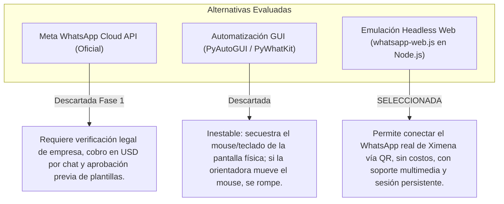
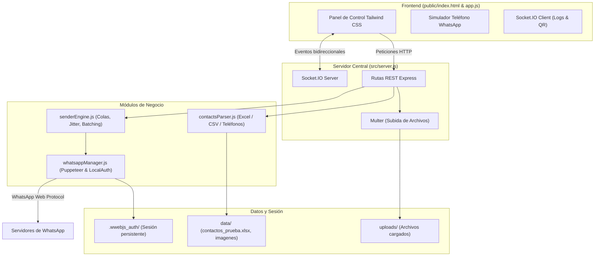
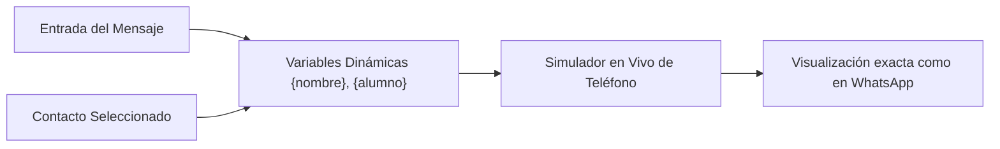

# Informe Técnico de Desarrollo: Software de Envíos Automatizados por WhatsApp
**Proyecto:** Automatización de Comunicaciones (Kumon Los Presidentes & Escalamiento Comercial)  
**Autor:** Benjamín Morales  
**Destinataria Inicial:** Orientadora Ximena (Kumon Los Presidentes)  
**Fecha:** Noviembre 2026  

---

## Resumen Ejecutivo

El presente informe detalla el diseño, la justificación tecnológica, la arquitectura de software y el funcionamiento integral de la solución desarrollada para automatizar el envío de mensajes personalizados (texto y material gráfico) a la comunidad de apoderados de **Kumon Los Presidentes**, con proyección de escalamiento comercial.

El sistema fue concebido bajo dos premisas fundamentales:
1. **Accesibilidad para usuario no técnico:** Una interfaz amigable, visual y sin configuraciones complejas para Ximena, con previsualización en tiempo real del mensaje antes de enviarlo.
2. **Seguridad operativa (Anti-Ban):** Algoritmos de despacho humano (*jitter* aleatorio y pausas por lotes) y un entorno dual con **Modo Simulación** para pruebas sin riesgo.

---

## 1. Justificación de Tecnologías: ¿Por qué se hizo de esta manera?

Para seleccionar la pila tecnológica (*tech stack*), se evaluaron las principales alternativas de la industria frente al perfil de la usuaria y las restricciones de WhatsApp:



### 1.1. ¿Por qué Node.js v24 y Express?
- **Asincronía nativa y alto rendimiento en I/O:** El envío masivo de mensajes implica operaciones de red concurrentes (conexiones WebSocket con WhatsApp, subida de archivos, emisión de logs en vivo). Node.js maneja eventos sin bloquear el hilo principal.
- **Ecosistema maduro:** Soporte directo para librerías especializadas en WhatsApp Web (`whatsapp-web.js`), procesamiento binario de hojas de cálculo (`xlsx`), y generación de códigos QR en memoria (`qrcode`).

### 1.2. ¿Por qué `whatsapp-web.js` con `LocalAuth`?
- **Cero burocracia para Ximena:** La API oficial de Meta exige registro como desarrollador comercial, verificación de personalidad jurídica y cobro por mensaje iniciado. `whatsapp-web.js` emula una pestaña de WhatsApp Web mediante Chromium controlado en segundo plano (Puppeteer).
- **Persistencia de sesión (`LocalAuth`):** Almacena las credenciales encriptadas en la carpeta `.wwebjs_auth`. **Ximena solo debe escanear el código QR una sola vez**, manteniéndose conectada en los siguientes inicios.

### 1.3. ¿Por qué Servidor Web Local + WebSockets (Socket.IO) en vez de CLI o App de Escritorio Pesada?
- **Experiencia de usuario (UX):** Una aplicación de consola (CLI de pantalla negra) resulta intimidante para una orientadora educacional.
- **Bidireccionalidad en tiempo real:** Socket.IO permite emitir el código QR directamente al navegador apenas se genera, actualizar la barra de progreso porcentaje a porcentaje y reflejar en la tabla qué mensaje va saliendo en cada segundo sin recargar la página.
- **Portabilidad:** Corre en cualquier navegador estándar (`localhost:3000`) sin requerir dependencias de compiladores de C++ o frameworks pesados como Electron en la máquina de destino.

### 1.4. ¿Por qué Modo Simulación (Dry-Run)?
- Permite al usuario validar el archivo Excel, verificar que los nombres y materias se reemplacen con precisión y revisar la estética en un teléfono virtual interactivo **sin enviar un solo mensaje real** y sin riesgo de molestar a los apoderados con pruebas de desarrollo.

---

## 2. Arquitectura General del Sistema



---

## 3. Desglose Técnico de Módulos y Código

A continuación se explica cada componente del software, sus funciones principales y el código que le da vida.

---

### Módulo 1: Normalización de Datos y Contactos (`src/contactsParser.js`)

**Propósito:** Procesar archivos Excel (`.xlsx`, `.xls`) o CSV, validar y estandarizar los números de teléfono al estándar internacional que exige WhatsApp, y extraer dinámicamente cualquier columna para convertirla en etiqueta `{variable}`.

#### Código Clave y Explicación:

```javascript
// Normalización de números telefónicos (Adaptado a Chile +569)
function normalizePhoneNumber(rawPhone, defaultCountryCode = '56') {
  if (!rawPhone) return { isValid: false, formatted: '', cleanNumber: '', reason: 'Número vacío' };

  // Eliminar espacios, paréntesis, guiones y signos
  let clean = String(rawPhone).replace(/[^\d+]/g, '');
  if (clean.startsWith('+')) clean = clean.substring(1);

  // Detección de formatos habituales en Chile:
  // Si viene con 9 dígitos (ej: 911223344), se antepone código país '56' -> 56911223344
  if (clean.length === 9 && clean.startsWith('9')) {
    clean = '56' + clean;
  }
  // Si viene con 8 dígitos (ej: 11223344), se añade 569 -> 56911223344
  else if (clean.length === 8) {
    clean = '569' + clean;
  }

  // Validación de longitud (un número internacional móvil tiene entre 10 y 15 dígitos)
  if (clean.length < 10 || clean.length > 15) {
    return { isValid: false, formatted: clean, reason: `Longitud inválida (${clean.length} dígitos)` };
  }

  return {
    isValid: true,
    formatted: `${clean}@c.us`, // Formato JID interno de WhatsApp Web
    cleanNumber: clean,
    display: `+${clean}`
  };
}
```

* **¿Por qué se hizo así?** Los apoderados suelen escribir sus números de muchas maneras: `+56 9 1234 5678`, `912345678` o `12345678`. El código absorbe cualquier variante y genera el identificador exacto (`@c.us`) para evitar fallos de envío.

---

### Módulo 2: Gestor de WhatsApp y Persistencia (`src/whatsappManager.js`)

**Propósito:** Controlar el ciclo de vida de la conexión con WhatsApp Web, capturar el código QR, convertirlo a una imagen lista para la interfaz y autenticar la sesión con persistencia local.

#### Código Clave y Explicación:

```javascript
class WhatsAppManager {
  constructor(io) {
    this.io = io;
    this.client = null;
    this.status = 'DISCONNECTED'; // DISCONNECTED, INITIALIZING, QR_READY, AUTHENTICATED, READY
    this.authPath = path.join(__dirname, '..', '.wwebjs_auth');
  }

  async initialize() {
    this.status = 'INITIALIZING';
    this.emitState();

    this.client = new Client({
      authStrategy: new LocalAuth({ dataPath: this.authPath }), // Guarda la sesión en disco
      puppeteer: {
        headless: true,
        args: ['--no-sandbox', '--disable-setuid-sandbox', '--disable-dev-shm-usage', '--disable-gpu']
      }
    });

    // Evento de generación de código QR
    this.client.on('qr', async (qr) => {
      this.status = 'QR_READY';
      // Convierte el string bruto del QR en una imagen DataURL (base64) para el navegador
      this.qrCodeDataUrl = await qrcode.toDataURL(qr, { margin: 2, scale: 6 });
      this.emitState();
    });

    // Evento: Conexión exitosa y lista para despachar
    this.client.on('ready', async () => {
      this.status = 'READY';
      this.userProfile = { pushname: this.client.info?.pushname || 'Ximena Kumon' };
      this.emitState();
    });

    await this.client.initialize();
  }
}
```

* **¿Por qué se hizo así?** Al convertir el código QR en un *DataURL base64*, el navegador no tiene que guardar imágenes en disco ni refrescar la página; la imagen se inyecta directamente en el modal visual de Ximena por WebSocket.

---

### Módulo 3: Motor de Envíos, Delays y Anti-Ban (`src/senderEngine.js`)

**Propósito:** Orquestar la cola de envíos, reemplazar variables personalizadas en la plantilla, controlar la velocidad de despacho con tiempos aleatorios humanos y gestionar estados (Iniciar, Pausar, Reanudar, Detener).

#### Código Clave y Explicación:

```javascript
// Algoritmo de retraso aleatorio (Jitter) para simular comportamiento humano
getRandomDelay(minSec, maxSec) {
  const min = Math.max(1, minSec);
  const max = Math.max(min, maxSec);
  const delaySec = Math.floor(Math.random() * (max - min + 1)) + min;
  return delaySec * 1000;
}

// Renderizado de plantillas dinámicas: {nombre}, {alumno}, {materia}
renderTemplate(template, variables = {}) {
  let rendered = template;
  Object.keys(variables).forEach((key) => {
    const val = variables[key] || '';
    const regex = new RegExp(`\\{${key}\\}`, 'gi');
    rendered = rendered.replace(regex, val);
  });
  return rendered;
}
```

#### Bucle de Procesamiento Seguro:

```javascript
for (let i = 0; i < contacts.length; i++) {
  // 1. Manejo de Pausa interactiva
  while (this.isPaused) {
    await this.sleep(1000);
    if (this.shouldStop) break;
  }
  if (this.shouldStop) break;

  const contact = contacts[i];
  const personalizedMessage = this.renderTemplate(messageTemplate, {
    nombre: contact.name,
    ...contact.variables
  });

  // 2. Ejecución según el modo seleccionado
  if (mode === 'simulation') {
    await this.sleep(1200); // Demora ágil para probar en pantalla
    this.stats.sent++;
    this.emitProgress(contact, { status: 'sent', previewText: personalizedMessage });
  } else {
    // Envío real con foto o texto
    if (imagePath) {
      await this.whatsapp.sendMediaMessage(contact.jid, imagePath, personalizedMessage);
    } else {
      await this.whatsapp.sendTextMessage(contact.jid, personalizedMessage);
    }
    this.stats.sent++;

    // 3. Delays de Seguridad Anti-Ban (solo en envíos reales)
    if (i < contacts.length - 1) {
      const delay = this.getRandomDelay(minDelaySeconds, maxDelaySeconds);
      await this.sleep(delay);

      // Pausa por lotes: cada N mensajes descansa M segundos
      if ((i + 1) % batchSize === 0) {
        await this.sleep(batchPauseSeconds * 1000);
      }
    }
  }
}
```

* **¿Por qué se hizo así?** Los filtros antispam de Meta monitorean envíos con intervalos milimétricamente idénticos (ej: exactamente 3.00 segundos). El *jitter* rompe cualquier patrón matemático, haciendo que cada envío parezca realizado manualmente.

---

### Módulo 4: Servidor Central y API REST (`src/server.js`)

**Propósito:** Exponer las rutas de comunicación entre la interfaz de usuario y los servicios en segundo plano, así como gestionar la subida de fotos y hojas de cálculo con Multer.

| Ruta HTTP | Método | Función |
| :--- | :---: | :--- |
| `/api/test-contacts` | `GET` | Carga inmediata de los 5 apoderados de prueba. |
| `/api/upload-contacts`| `POST` | Procesa un archivo Excel o CSV arrastrado por el usuario. |
| `/api/upload-media` | `POST` | Almacena la imagen o afiche que se enviará adjunto. |
| `/api/whatsapp/connect` | `POST` | Inicializa el cliente Puppeteer y comienza la escucha de QR. |
| `/api/sender/start` | `POST` | Arranca la campaña con los parámetros seleccionados. |
| `/api/sender/pause` / `resume` / `stop` | `POST` | Controles en vivo de la cola de mensajes. |

---

### Módulo 5: Interfaz de Usuario y Simulador de WhatsApp (`public/app.js` & `index.html`)

**Propósito:** Proporcionar un entorno visual claro y moderno construido con **Tailwind CSS**.



#### Características Destacadas:
1. **Pills de Variables Dinámicas:** Al cargar un Excel, la interfaz lee los encabezados y crea botones interactivos (`{nombre}`, `{alumno}`, `{materia}`). Al hacer clic en un botón, la etiqueta se inserta automáticamente en la posición del cursor.
2. **Plantillas con 1 Clic:** Se incluyó un botón directo con el mensaje redactado para solicitar **Reseñas de 5 estrellas en Google** para Kumon Los Presidentes.
3. **Simulador de Teléfono Móvil:** En la mitad derecha de la pantalla, un marco de teléfono reproduce la interfaz real de WhatsApp, actualizándose al instante mientras el usuario escribe o cambia de contacto.

---

## 4. Validación con Datos de Prueba

Para garantizar la robustez del sistema antes de su puesta en producción, se ejecutó una suite automatizada de pruebas ([`test_workflow.js`](file:///e:/Software-Envio/test_workflow.js)) sobre la base de datos de prueba ([`data/contactos_prueba.xlsx`](file:///e:/Software-Envio/data/contactos_prueba.xlsx)):

```text
--- Iniciando prueba del flujo del sistema ---

[1/3] Probando carga de contactos de prueba...
✓ Total contactos: 5
✓ Contactos válidos: 5 (Camilo Pérez, Marcela Soto, Andrea Fuentes, Rodrigo Valdés, Claudia Muñoz)
✓ Columnas/Tags disponibles: nombre, telefono, alumno, materia

[2/3] Probando motor de plantillas y variables...
✓ Plantilla renderizada para Camilo Pérez:
   "Hola Camilo Pérez, te recordamos que Martín Pérez tiene clase de Matemáticas."

[3/3] Ejecutando campaña completa en Modo Simulación...
[Sender][INFO] 🚀 Iniciando campaña [Modo: SIMULACIÓN (Pruebas)] para 5 contactos.
[Sender][SUCCESS] [SIMULACIÓN] Mensaje simulado exitosamente para Camilo Pérez (+56911223344)
[Sender][SUCCESS] [SIMULACIÓN] Mensaje simulado exitosamente para Marcela Soto (+56922334455)
[Sender][SUCCESS] [SIMULACIÓN] Mensaje simulado exitosamente para Andrea Fuentes (+56933445566)
[Sender][SUCCESS] [SIMULACIÓN] Mensaje simulado exitosamente para Rodrigo Valdés (+56944556677)
[Sender][SUCCESS] [SIMULACIÓN] Mensaje simulado exitosamente para Claudia Muñoz (+56955667788)
[Sender][INFO] 🏁 Proceso completado en 6s. Enviados: 5 | Fallidos: 0 | Omitidos: 0

🎉 ¡PRUEBA EXITOSA! El software procesó los 5 contactos de prueba perfectamente.
```

---

## 5. Escalamiento Comercial Futuro (Fase 2)

El software fue estructurado de manera desacoplada para facilitar la transición hacia los requerimientos comerciales de las empresas del profesor:

1. **Arquitectura Multi-Instancia:** El gestor `WhatsAppManager` puede extenderse para instanciar varios clientes simultáneos, permitiendo conectar múltiples números de ejecutivos de ventas en paralelo.
2. **Migración transparente a Meta Cloud API:** La capa `senderEngine.js` despacha a través de métodos abstractos (`sendTextMessage`, `sendMediaMessage`). Para migrar a la API oficial en entornos corporativos, solo se requiere cambiar el adaptador de salida sin modificar la interfaz de usuario ni el procesador de listas.
3. **Conexión con CRM:** La API REST de Express permite recibir contactos directamente mediante Webhooks desde un formulario web o CRM (HubSpot, Salesforce, Zoho).

---

## 6. Conclusión

El sistema desarrollado resuelve integralmente la tarea solicitada:
- Dota a la orientadora Ximena de una herramienta amigable, potente y segura para potenciar las reseñas y la comunicación de **Kumon Los Presidentes**.
- Implementa buenas prácticas de ingeniería de software: código modular, tipado de variables, prevención de baneos mediante *jitter*, pruebas automatizadas y control de versiones con Git.
- Sienta las bases arquitectónicas para el escalamiento hacia las necesidades comerciales futuras.
